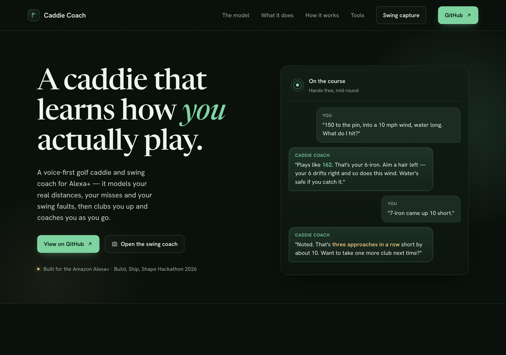

# Caddie Coach

**A voice golf caddie and swing coach for Alexa+ that learns how you actually play: your real distances, your misses, and your swing faults. Built as a self-hosted MCP server for the Amazon Alexa+ "Build, Ship, Shape" Hackathon 2026.**

[](https://github.com/hammy229/caddie-coach/actions/workflows/ci.yml)
[](LICENSE)

**Links:** [Architecture](docs/ARCHITECTURE.md) · [Deploy guide](infra/README.md) · [Hackathon write-up](docs/DEVPOST_SUBMISSION.md) · [OAuth library: alexa-mcp-oauth](https://github.com/hammy229/alexa-mcp-oauth) · [Arham Doshi](https://arhamdoshi.dev) · [LinkedIn](https://linkedin.com/in/arhamdoshi)



**Demo video coming soon.**

> "Alexa, start a round at Butler Park. I'm feeling aggressive today."
> "Alexa, 150 to the pin into a 10 mile an hour wind, water long. What should I hit?"
> "Alexa, 7 iron came up 10 short."
> *"Got it. Your last 3 approach shots came up short by about 10 yards. Want to take one more club?"*
> "Alexa, how should I play this hole? It's a 520 par 5, water left of the green."
> *"Off the tee, driver. Next, lay up and leave 110 in. Then, pitching wedge into the green."*
> "Alexa, how was that swing?"
> *"From the top, your hands moved out toward the ball before they dropped... That's 3 swings in a row coming over the top."*
> "Alexa, I've got 30 minutes at the range. What should I work on?"
> *"You've been coming over the top 3 swings in a row. Headcover gate, 10 minutes: set a headcover just outside the ball..."*
> "Alexa, I'm done. I shot 88."

## Results

| Claim | Measured | How it is checked |
|---|---|---|
| The whole product works end to end | 145 tests in 15 files pass, including contract tests that drive the real HTTP server with the MCP SDK client | `npm test` in `server/`, and CI on every push |
| It does more than answer questions | 10 MCP tools and 3 MCP App cards: club advice, hole plans, shot logging, putting, swing analysis, practice plans, round reports, and a game profile | [Tools](#tools) below |
| Advice is personal, not a generic chart | Club choice uses your own carry and miss from your last 20 full swings per club | `server/src/domain`, with unit tests for the dispersion model and caddie engine |
| Swing coaching works without uploading video | Pose runs in the browser and only 6 body keypoints per frame reach the server | Swing analyzer tests on synthetic good, over-the-top, early-extension, and rushed swings |
| It deploys with one command | Lambda container behind an HTTPS Function URL, DynamoDB, and Bedrock, from `sam build && sam deploy` | [`infra/template.yaml`](infra/template.yaml) |
| Its account linking became a library | The OAuth 2.1 server was extracted as [alexa-mcp-oauth](https://github.com/hammy229/alexa-mcp-oauth) | That repo's checklist tests |

## Why it matters

Most golf apps hand you a generic club chart. Real golfers miss in personal ways: one player's 7-iron goes 140 and drifts right, another's goes 155 and hooks. Caddie Coach keeps a running model of how you hit each club and uses it, with wind, elevation, hazards, and how much risk you want, to pick a club and an aim point. It runs by voice, so it works mid-round with your hands on a club instead of a phone.

## How it works

```
                     ┌──────────────────────────────┐
 Alexa+ ── add-on ──►│  Caddie Coach MCP server      │──► DynamoDB (shots, swings, rounds)
                     │  Streamable HTTP, 2025-11-25  │──► Amazon Bedrock (post-round recap)
                     │  10 tools + 3 MCP App cards   │
 Phone camera ──────►│  /capture  →  /api/swings     │
 (pose in browser)   └──────────────────────────────┘
```

- **Personal dispersion model**: per-club mean and spread of carry and lateral miss from your last 20 full swings. Typical amateur numbers are used until a club has 3 logged shots.
- **Caddie engine**: computes the plays-like distance (wind, elevation), then scores every club by the probability of landing in the target zone minus a risk-weighted chance of finding the trouble. Aim is offset for your usual miss and crosswind.
- **Pattern detection**: every `log_shot` checks for streaks (approaches short or long, tee shots missing one side, a club going shorter than usual) and returns them in the same response, so Alexa+ raises them without being asked.
- **Swing analysis**: the capture page runs MediaPipe Pose in the browser and uploads 6 body keypoints per frame (no video). The server measures tempo (backswing to downswing ratio), early extension (loss of spine tilt at impact) and over-the-top (hands moving away from the body faster than they drop at the start of the downswing).
- **Strokes gained**: approach and putting strokes gained against PGA Tour benchmark baselines (Broadie), from the proximity of your logged approaches and the length of your putts.
- **Course strategy**: `plan_hole` works a hole backwards from a comfortable approach distance: which club off the tee, whether to go for a par 5 or lay up, using your own carries and risk appetite.
- **Practice plans**: `practice_plan` scores drills against your recurring swing faults and the part of your game losing the most strokes, then fills the time you have, hardest fix first.
- **Handicap**: a World Handicap System index and scoring average from your scored rounds (course rating and slope when you give them, par otherwise).
- **Post-round report**: fairways, approach accuracy, dominant miss, strokes gained, putts, club distances vs your usual, swing faults, and the trend against earlier rounds. Bedrock writes the spoken recap when configured.
- **MCP Apps**: `end_round` shows a round report card, `analyze_swing` a swing check card, and `practice_plan` a practice plan card.

| Choice | Why |
|---|---|
| An MCP server instead of a classic Alexa skill | Alexa+ add-ons speak MCP, so the same server also works in any MCP client, like the MCP Inspector |
| Pattern checks run inside `log_shot` | Alexa+ can bring up "three approaches short in a row" without being asked |
| Pose estimation in the browser, keypoints only | Faster, cheaper, and no swing video ever leaves the phone |
| Stateless HMAC-signed OAuth | No session store to run, so it deploys as one Lambda |
| A simulated Alexa+ host at `/alexa` | Judges and reviewers can try the real MCP traffic without Amazon-side access |

### Tools

| Tool | What it does |
|---|---|
| `start_round` | Starts a round at a course, optionally with risk tolerance, par, rating and slope |
| `set_risk_tolerance` | Safe, normal or aggressive. Changes how club advice weighs trouble |
| `log_shot` | Records club, target, carry and lateral miss; returns pattern insights |
| `log_putt` | Records a putt and reports putting strokes gained |
| `recommend_club` | Picks a club and aim point from your own dispersion and the conditions |
| `plan_hole` | A shot-by-shot game plan for a hole from your distances and risk |
| `practice_plan` | Builds a practice session from your faults and weakest strokes-gained category |
| `analyze_swing` | Coaches your latest captured swing and compares it with earlier swings |
| `end_round` | Ends the round and returns the report and spoken recap |
| `get_game_profile` | Your distances, misses, swing faults, strokes gained and handicap index |

## Tech stack

TypeScript, Node 22, the MCP TypeScript SDK (Streamable HTTP, spec 2025-11-25), MCP Apps, MediaPipe Pose, Vitest, AWS Lambda with the Lambda Web Adapter, DynamoDB, Amazon Bedrock, AWS SAM, GitHub Actions.

## Getting started

Requires Node 22+.

```bash
cd server
npm install
npm run dev
# MCP endpoint:  http://localhost:3000/mcp
# Capture page:  http://localhost:3000/capture?user=demo-user
# Alexa+ sim:    http://localhost:3000/alexa
```

### Try it as a voice assistant

Open http://localhost:3000/alexa in Chrome. It is a simulated Alexa+ host (the rules' alternate Alexa+ path): talk with the mic button or type, and it speaks the reply. A small rule-based mapper (`server/src/web/intents.ts`) turns each sentence into one tool call in place of the Alexa+ model; the tool call itself is real MCP JSON-RPC from the browser to `/mcp`, the cards are the real MCP Apps resources rendered in a sandboxed iframe over the `ui/*` postMessage bridge, and every message is shown in the traffic panel. **Load an earlier round** seeds history so trends, strokes gained and handicap have data; the demo requests are one click each. The simulator runs only without OAuth, since it identifies the golfer with `x-user-id`.

Test the tools with the MCP Inspector:

```bash
npx @modelcontextprotocol/inspector
# Transport: Streamable HTTP, URL: http://localhost:3000/mcp, header x-user-id: demo-user
```

The capture page needs camera access, which browsers only allow on `https://` or `localhost`. To use a phone against a local server, put it behind an HTTPS tunnel.

### Configuration

Copy `.env.example` to `.env`. Everything is optional for local runs.

| Variable | Purpose |
|---|---|
| `PORT` | Server port (default 3000) |
| `DDB_TABLE` | DynamoDB table (partition key `userId`, String). Unset = in-memory store |
| `BEDROCK_MODEL_ID` | Bedrock model for the spoken round recap. Unset = template recap |
| `AWS_REGION` | Region for DynamoDB and Bedrock |
| `OAUTH_SIGNING_SECRET` | Turns OAuth on. Secret that signs codes and tokens (32+ random characters). Unset = local dev, identity from `x-user-id` |
| `OAUTH_CLIENT_SECRET` | Client secret the Alexa+ add-on uses. Required when OAuth is on |
| `OAUTH_CLIENT_ID` | Client id (default `alexa-plus`) |
| `OAUTH_REDIRECT_URIS` | Comma-separated redirect URIs account linking may return to |
| `PUBLIC_BASE_URL` | Public https origin used as the OAuth issuer. Derived from each request when unset |

### Deploy to AWS

The server ships as a container image and runs on AWS Lambda behind an HTTPS Function URL (via the Lambda Web Adapter), with state in DynamoDB and recaps from Bedrock. One command, with the [SAM CLI](https://docs.aws.amazon.com/serverless-application-model/latest/developerguide/install-sam-cli.html) and Docker:

```bash
cd infra
sam build && sam deploy
```

`sam deploy` prints the Function URL; the MCP endpoint is that URL + `/mcp`. Full steps, the Bedrock option and teardown are in [infra/README.md](infra/README.md).

### Connect to Alexa+

Alexa+ needs a remote HTTPS Streamable HTTP endpoint (the Function URL above) with OAuth account linking. The server includes its own OAuth 2.1 authorization server, so there is nothing else to host:

- `GET /.well-known/oauth-protected-resource` (RFC 9728) and `/.well-known/oauth-authorization-server` (RFC 8414, `S256` PKCE only)
- `GET|POST /authorize`: a small page where the golfer picks a name and PIN; the same pair always reaches the same data
- `POST /token`: `authorization_code` with PKCE, and `refresh_token`
- `/mcp` and `/api/swings` return 401 without a valid bearer token

Codes and tokens are HMAC-signed and stateless, so no extra storage is needed. Turn it on by deploying with `OAuthSigningSecret`, `OAuthClientSecret` and `OAuthRedirectUris` (see [infra/README.md](infra/README.md)), then register the add-on:

```bash
alexa-ai configure
alexa-ai new mcp --name "Caddie Coach" --locale en-US --mcp-server-url "https://<function-url>/mcp"
alexa-ai deploy
```

See [docs/ARCHITECTURE.md](docs/ARCHITECTURE.md).

## Project structure

```
server/src/tools/    the 10 MCP tools
server/src/domain/   dispersion model, caddie engine, strokes gained, handicap, swing analyzer, practice plans
server/src/state/    DynamoDB and in-memory stores
server/src/auth/     the OAuth 2.1 authorization server
server/src/apps/     the 3 MCP App cards
server/src/web/      capture page, simulated Alexa+ host, intent mapper
server/tests/        unit and end-to-end contract tests
infra/               AWS SAM template and deploy guide
docs/                architecture, demo script, friction log, submission notes
```

## Testing

```bash
cd server
npm run lint     # type check
npm test
```

145 tests: the OAuth server (PKCE, refresh, redirect and client checks), the simulated host's intent mapper, the stats helpers, dispersion model, caddie engine, strokes-gained baselines, practice-plan and hole-strategy engines, handicap index, pattern detector and swing analyzer (on synthetic pose data for good, over-the-top, early-extension and rushed swings), the narrator and spoken recap, the round report, and end-to-end contract tests that drive the real HTTP server with the MCP SDK client. CI runs the type check and tests on every push.

## Limitations and next steps

- The live Alexa+ add-on is not running yet: the `alexa-ai` CLI needs Amazon-side access (friction log F-7). The simulated host at `/alexa` stands in for it.
- The SAM stack is written and tested locally but has not run in a live AWS account.
- The capture page has been tested on synthetic pose data, not yet on real swings.
- See [docs/SUBMISSION_CHECKLIST.md](docs/SUBMISSION_CHECKLIST.md) for what is done and [docs/ARCHITECTURE.md](docs/ARCHITECTURE.md) for the design.

## License

MIT, see [LICENSE](LICENSE). Built by [Arham Doshi](https://arhamdoshi.dev).
